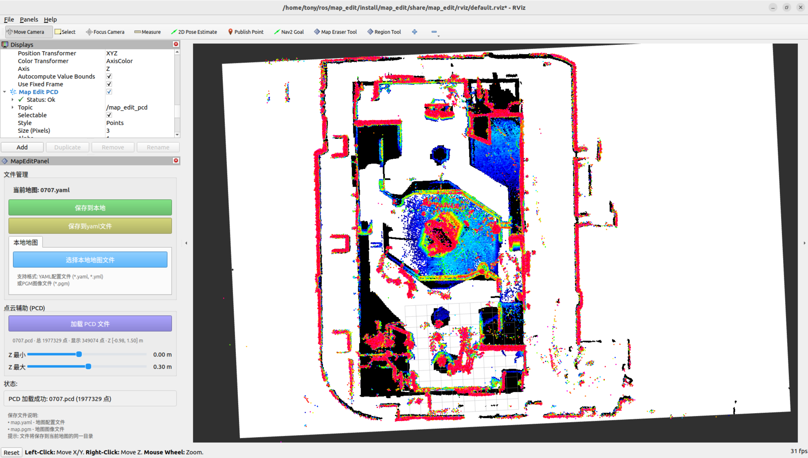
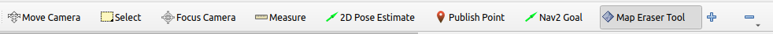
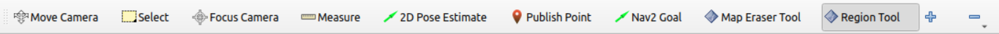
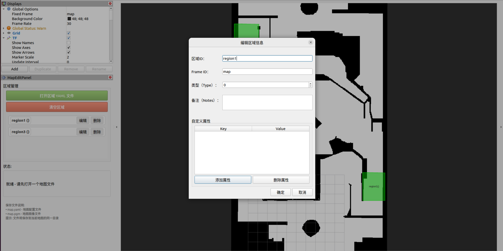

<!--
 * @Author: Tonytpc ykq31415926@163.com
 * @Date: 2025-07-09 22:24:31
 * @LastEditors: Tonytpc ykq31415926@163.com
 * @LastEditTime: 2026-01-27 23:00:00
 * @FilePath: /map_edit/readme.md
 * @Description: 这是默认设置,请设置`customMade`, 打开koroFileHeader查看配置 进行设置: https://github.com/OBKoro1/koro1FileHeader/wiki/%E9%85%8D%E7%BD%AE
-->
# ROS2 Map Edit Plugin
一个用于RViz的地图编辑插件，支持地图编辑功能。
> 本项目参考于 [ros_map_edit](https://gitee.com/reinovo/ros_map_edit) ，并做了Ros2兼容性修改。
> 演示视频：[map_edit地图编辑工具](https://www.bilibili.com/video/BV1XPtJzbEn8)


## 功能特点
- **🎯 告别 GIMP 手动像素换算的烦恼！ —— 一眼精确，点哪改哪！**
- **🧩 兼容 RViz 各类组件，直接获取障碍物点云 🔍 —— 修图不再盲修，修改更有“理”！**
- **🛠️ 边导航边修图，哨兵撞墙？马上改地图！ —— 实时修，边走边改，效率飙升！**
- **💾 一键保存为 .pgm + .yaml 文件 ✅ —— 操作简单，直接接入导航用！**
- **🗺️ 区域标注工具：绘制多边形区域并保存为 YAML ✅ —— 灵活定义禁行区/感兴趣区等！**


## 版本更新
- **v1.28**
  - 新增 PCD 点云辅助功能：加载 PCD 文件，通过 Z 高度滑块过滤显示，辅助修图
  - 点云按高度 Jet 渐变着色（蓝→红）发布到 `/map_edit_pcd`，在 RViz 中清晰区分
- **v1.27**
  - 新增 `RegionTool` 区域标注工具：在地图上绘制多边形区域，支持 YAML 导入/导出
  - 面板新增「区域管理」界面（打开/保存/清空区域 YAML）
  - 重建撤销策略：改为像素级备份，支持多步撤销与重做
  - 区域数据存储由 JSON 改为 YAML（依赖 yaml-cpp）

## 编译与运行


```zsh
mkdir -p ~/ros2_ws/src
cd ~/ros2_ws/src
git clone https://github.com/Tony-tpc/map_edit
cd ..
```

1. 安装依赖

    ```zsh
    rosdepc install -r --from-paths src --ignore-src --rosdistro $ROS_DISTRO -y
    ```
2. 编译

    ```zsh
    colcon build --symlink-install
    ```

3. 运行

    ```zsh
    . install/setup.bash
    ros2 launch map_edit map_edit.launch.py 
    ```
---
## 使用说明

### 1. 打开地图

#### 方式一：打开本地文件
1. 点击 `选择本地地图文件` 按钮
2. 选择`YAML` 对应的地图文件
3. 地图自动加载

#### 方式二：边导航边修图

1. 运行 `map_edit rviz` 插件
2. 运行其他导航节点
3. rviz自动获取/map话题，并显示地图
4. 此时即可根据导航节点的点云或导航效果修改地图


>[!NOTE]  
>修改后的地图发布在`/map_edit`话题下，并不会对导航产生影响，只有保存地图且导航节点重新加载pgm后才会生效

### 2. 地图编辑： MapEraserTool - 黑白橡皮擦


>使用橡皮擦：左键画黑色，右键画白色

**快捷键说明：**
- ⬆️ / ⬇️：调整笔刷大小  
- **Ctrl + Z**：撤销上一步修改  
- **Ctrl + Y / Ctrl + Shift + Z**：重做  
- **Shift + 左/右键**：画直线（起点-终点自动连接）  


### 3. 点云辅助（PCD 加载与 Z 过滤）

> 加载 PCD 点云叠加到地图上，作为修图参考（例如根据障碍物点云判断黑色区域边界）


**操作步骤：**
1. 点击面板「点云辅助 (PCD)」组中的 `加载 PCD` 按钮，选择 `.pcd` 文件
2. 加载成功后自动显示全部点云，并初始化 Z 范围滑块
3. 拖动 **Z 最小 / Z 最大** 滑块，按 **0.05 m** 的最小步进过滤显示指定高度范围内的点云，实时更新
4. 默认坐标系为 `map`（与地图对齐），可修改「坐标系」输入框（如 `odom`）

**显示效果：**
- 点云按高度 **Jet 渐变着色（蓝→红，低→高）**，与地图灰度形成明显区分
- 过滤后的点云发布到 `/map_edit_pcd` 话题，RViz 中以 **Map Edit PCD** 显示（Points 样式，3px）

### 4. 区域标注： RegionTool - 多边形区域工具


> 在 RViz 工具栏中选择 `Region Tool`，绘制多边形区域（如禁行区、标注区等）

**绘制区域：**
1. 按住 **Shift** + **左键**：依次点击，逐个添加多边形顶点
2. 绘制过程中按住 Shift并移动鼠标显示红色辅助预览线，当前绘制中的区域轮廓以蓝色显示
3. **右键**：完成当前区域绘制（顶点数 ≥ 3 才会生成区域）

**拖动顶点：**
1. 先**左键**点击选中目标区域（红色高亮）
2. 再次**左键**点击该区域内靠近某个顶点的位置
3. **按住左键拖动**：实时移动该顶点位置，松开左键结束拖动

### 5. 区域管理（YAML 导入/导出）

> 切换到 `Region Tool` 后，面板自动切换为「区域管理」界面


1. **打开区域 YAML 文件**：加载已保存的区域配置（需先加载地图）
2. **保存到yaml文件**：将当前所有区域导出为 YAML 文件（仅保存顶点数 ≥ 3 的区域）
3. **清空区域**：删除所有区域
4. 区域列表实时刷新，支持多区域管理

#### 区域 YAML 输出格式

```yaml
regions:
  - id: region_1                # 区域唯一标识
    frame_id: map               # 区域所在坐标系
    type: 0                     # 区域类型（整数，可自定义含义）
    notes: ""                   # 备注说明
    points:                     # 多边形顶点（世界坐标，与地图同坐标系）
      - x: 1.5
        y: -2.0
        z: 0.0
      - x: 3.2
        y: -2.0
        z: 0.0
      - x: 3.2
        y: 1.8
        z: 0.0
    # 自定义属性（扁平结构，键值均为字符串，可选）
    speed_limit: "0.5"
    is_forbidden: "true"
  - id: region_2
    frame_id: map
    type: 1
    notes: "障碍物区域"
    points:
      - x: 10.0
        y: 10.0
        z: 0.0
      - x: 12.0
        y: 10.0
        z: 0.0
      - x: 12.0
        y: 12.0
        z: 0.0
```

> 字段说明：
> - `regions`：顶层序列，包含所有区域
> - 每个区域必须包含 `id`、`frame_id`、`type`、`points`，`notes` 可为空字符串
> - `points` 为闭合多边形顶点序列，至少需要 3 个点
> - 区域的自定义属性（`attributes`）以扁平键值对形式直接写入区域层级


### 6. 地图保存

1. 点击 `保存到本地` 按钮
2. 选择保存路径
3. 自动补全 `pgm` 与 `yaml` 文件
4. 保存成功

## ✅ TODO List

- [x] 增加撤销功能(需优化)
- [x] 重建撤销策略：像素级备份，支持多步撤销与重做
- [x] 增加画直线功能
- [x] 增加区域标注工具（RegionTool）
- [x] 区域数据 YAML 导入/导出
- [x] 加载 PCD 点云辅助修图（Z 高度范围过滤显示）
- [ ] 逐步实现 `gimp` 相关功能


